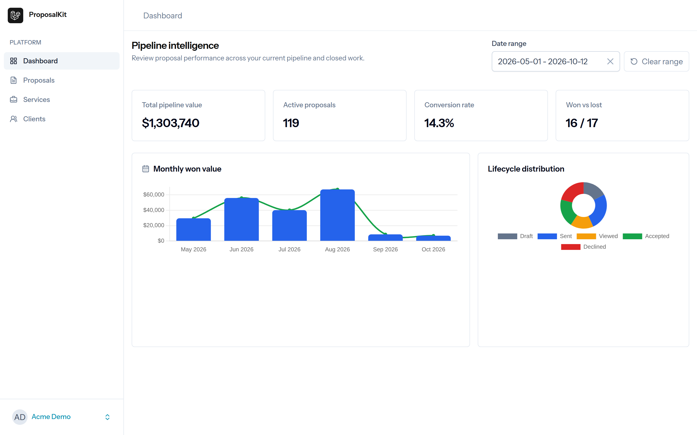
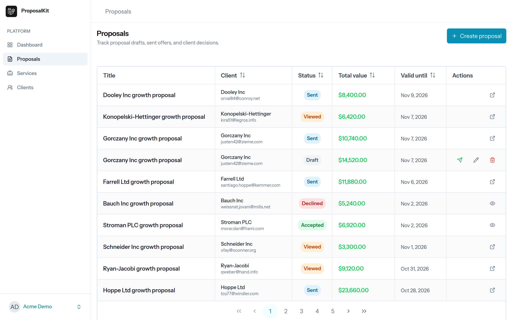
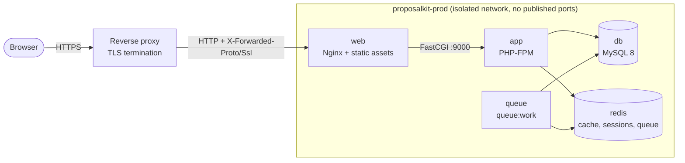

# ProposalKit

[](https://github.com/brunovhk/proposalkit/actions/workflows/ci.yml)
[](LICENSE)


ProposalKit is a Laravel 13 and Vue 3 SaaS platform for building, sending, tracking, and digitally accepting commercial proposals inside tenant-isolated workspaces.

ProposalKit is developed with a strict focus on data integrity, explicit multi-tenant boundaries, and immutable logs. The architecture isolates commercial documents, enforces cryptographic protections against client-side tampering, and tracks all lifecycle state transitions with structural evidence variables.

**Live demo:** <https://proposalkit.brunovhk.dev>

The demo signs you in with one click from the landing page and runs against fictional data. It is read-only: create, edit, and delete operations are blocked for the demo account.

## Screenshots





## Features

- Multi-tenant workspace isolation backed by a single database, tenant-aware models, and dedicated isolation tests.
- Service catalog management for tenant-owned billable services and pricing defaults.
- Client management for tenant-owned customer records.
- Proposal builder with itemized pricing, totals, validity windows, and controlled lifecycle transitions.
- Asynchronous proposal PDF generation and delivery workflows.
- Secure public proposal experience for unauthenticated recipients using signed URLs, typed-name acceptance, rejection capture, PDF download, and replay protection.

## Tech Stack

| Layer | Technology |
| --- | --- |
| Backend | PHP 8.4, Laravel 13 |
| Frontend | Inertia.js, Vue 3, TypeScript |
| UI | PrimeVue, Tailwind CSS v4 |
| Database | MySQL 8 |
| Cache / Queue | Redis, Laravel Queues |
| Auth | Laravel Fortify |
| PDF | DOMPDF-backed proposal rendering |
| State Machine | Spatie Laravel Model States |
| Code Quality | Laravel Pint, Rector, Larastan Level 8, PHPUnit, ESLint, Prettier, Vue TypeScript checks |

## Requirements

- PHP 8.4+
- Composer 2
- Node.js 22+
- npm
- MySQL 8
- Redis

Docker and Docker Compose v2 can replace all of the above. See [Installation & Environments](#installation--environments).

## Architecture Highlights

### Tenant Isolation

Tenant ownership is enforced through tenant-scoped models and global scope conventions. Feature code does not manually filter by tenant IDs; tenant boundaries live in the model layer and are verified through automated tests.

### Proposal State Machine

Proposal status is modeled through `spatie/laravel-model-states`, not raw strings. The application transitions proposals through concrete state classes such as `Draft`, `Sent`, `Viewed`, `Accepted`, and `Declined`, with invalid transitions blocked by the state machine and covered by tests. This prevents illegal business mutations, such as modifying or re-accepting a proposal after the commercial document has already been finalized.

### Polymorphic Lifecycle Auditing

Proposal activity is persisted in an append-only `proposal_events` audit trail. Events support polymorphic actors for authenticated tenant users while keeping unauthenticated guest client activity decoupled from application user accounts. Public interactions capture legal evidence such as IP address, User-Agent, timestamps, typed-name acceptance data, rejection reason, and referrer metadata where applicable. This creates a durable record of who acted, what changed, and which client-side evidence accompanied the decision.

### HMAC-Signed Public Access

Public proposal routes use the secure layout `/p/{tenant_slug}/{secure_token}` and Laravel signed URL validation. Public links avoid auto-increment identifiers, eliminate ID enumeration exposure, include per-proposal secure tokens, expire against the proposal validity window, and return `410 Gone` for finalized records where replay or document tampering must be prevented.

### Decoupled Action Layer

Models remain clean from HTTP session concerns. Actor resolution, public evidence capture, state transitions, PDF streaming, and proposal response handling are delegated to dedicated Action classes and shared concerns. Controllers orchestrate requests and responses; they do not own business rules. This keeps compliance-sensitive behavior explicit, testable, and isolated from persistence models.

### PHP 8.4 Runtime

The backend targets PHP 8.4 to keep the application aligned with the Laravel 13 ecosystem and modern package requirements. Strong typing, current language features, and static-analysis-friendly code reduce ambiguity in business-critical flows such as proposal transitions, tenant ownership, and client acceptance evidence.

### Private PDF Delivery

Generated proposal PDFs are stored outside the public web root and streamed through signed public routes. This keeps document access governed by the same token, signature, and lifecycle policies as the public proposal interface.

## Installation & Environments

ProposalKit supports three setups. Pick the one that fits your goal:

| Setup | Best for | Services |
| --- | --- | --- |
| [Native](#1-localhost-deployment-native) | Fast local iteration | Your own PHP, MySQL, Redis, Node |
| [Docker (development)](#2-localhost-deployment-docker-development) | Reproducible local stack, no host toolchain | `compose.yaml` |
| [Docker (production)](#3-production-deployment-docker-architecture) | Hardened, immutable deployment | `compose.prod.yaml` |

### 1. Localhost Deployment (Native)

**Prerequisites:** PHP 8.4+ (with `pdo_mysql`, `redis`, `gd`, `intl`, `zip`, `pcntl`), Composer 2, Node.js 22+ with npm, MySQL 8, and Redis.

Install dependencies:

```bash
composer install
npm ci
```

Create the environment file and generate the application key:

```bash
cp .env.example .env
php artisan key:generate
```

Create an empty MySQL database and a user with access to it, using your native tooling:

```bash
mysql -u root -p -e "CREATE DATABASE proposalkit CHARACTER SET utf8mb4 COLLATE utf8mb4_unicode_ci;"
```

Then set the connection values in `.env` (`DB_*` and `REDIS_*`) and build the schema with demo data:

```bash
php artisan migrate:fresh --seed
php artisan wayfinder:generate
```

Start the application, queue worker, and Vite development server together:

```bash
composer dev
```

Or run them in separate terminals:

```bash
php artisan serve
php artisan queue:listen --tries=1
npm run dev
```

The app is available at <http://localhost:8000>.

### 2. Localhost Deployment (Docker Development)

**Prerequisites:** [Docker](https://docs.docker.com/get-docker/) and Docker Compose v2. No local PHP, Node, MySQL, or Redis is required.

The development stack in `compose.yaml` runs `app` (PHP-FPM with Xdebug), `web` (Nginx), `node` (Vite), `queue` (worker), `db` (MySQL 8), and `redis`. The project directory is bind-mounted into the containers, so code changes apply immediately.

Create the environment file. Set `UID` and `GID` to your own values (`id -u`, `id -g`) to avoid file permission issues on bind mounts:

```bash
cp .env.development.example .env
```

Build the images and install PHP dependencies first, because the project is mounted from the host and the Vite plugin needs `vendor/`:

```bash
docker compose build
docker compose run --rm app composer install
```

Start the stack, then generate the key and build the database:

```bash
docker compose up -d
docker compose exec app php artisan key:generate
docker compose exec app php artisan migrate:fresh --seed
```

| Service | URL |
| --- | --- |
| Application | <http://localhost:8080> |
| Vite dev server (HMR) | <http://localhost:5173> |
| MySQL / Redis (host access, bound to `127.0.0.1` only) | `localhost:3306` / `localhost:6379` |

**Vite and HMR.** Frontend tooling is fully isolated in the `node` container. It runs `npm ci` and `npm run dev -- --host 0.0.0.0` on startup, and exposes Hot Module Replacement on port `5173`, so no Node installation is needed on the host. Follow its output with:

```bash
docker compose logs -f node
```

**Running tools inside the runtime container.** Use `docker compose exec app` for everything PHP:

```bash
docker compose exec app php artisan migrate
docker compose exec app composer test
docker compose exec app ./vendor/bin/phpstan analyse
docker compose exec app php artisan test
```

All containers that write to the project directory run as your own user (`UID` and `GID` from `.env`), so generated files such as `node_modules/` stay owned by you. If an earlier run left root-owned files behind, reclaim them once:

```bash
sudo chown -R "$(id -u):$(id -g)" node_modules public resources/js storage bootstrap/cache
```

If MySQL or Redis already run on your machine, `docker compose up` fails with `address already in use`. Pick other host ports in `.env` (for example `DB_FORWARD_PORT=3307` and `REDIS_FORWARD_PORT=6380`) and start the stack again. The containers keep talking to each other on the default ports, so nothing else changes.

Stop the stack with `docker compose down`. Add `-v` to also remove the database and Redis volumes.

### 3. Production Deployment (Docker Architecture)

`compose.prod.yaml` defines an isolated, self-contained stack built from a single multi-stage `docker/common/php-fpm/Dockerfile`:

| Service | Image target | Role |
| --- | --- | --- |
| `app` | `production` | PHP-FPM with OPcache and JIT, running as `www-data` |
| `web` | `web-production` | Nginx serving static assets and proxying PHP to `app:9000` |
| `queue` | `production` | `php artisan queue:work` |
| `db` | `mysql:8.0` | Persistent database volume |
| `redis` | `redis:7-alpine` | Password-protected cache, session, and queue backend |



**Multi-stage build.** Dependencies and assets are compiled in an isolated `builder` stage (`composer install --no-dev` and `npm run build`), so the final images contain no Node, Composer, or build tooling. The `web-production` image copies only the compiled `public/` directory from the builder, which makes the Nginx container immutable and lets it serve static files directly, without involving PHP.

**Network isolation.** `db` and `redis` publish no ports. They are unreachable from the host machine and communicate exclusively with `app` and `queue` over the internal `proposalkit-prod` network. The only published port is the `web` service, bound to `NGINX_PORT` (default `80`).

Configure the environment. Set strong values for `DB_PASSWORD` and `REDIS_PASSWORD`, and set `APP_URL` to your public HTTPS URL:

```bash
cp .env.production.example .env
docker compose -f compose.prod.yaml run --rm --no-deps app php artisan key:generate --show
```

Paste the generated key into `APP_KEY` in `.env`, then build and start the stack:

```bash
docker compose -f compose.prod.yaml up -d --build
docker compose -f compose.prod.yaml exec app php artisan migrate --force
docker compose -f compose.prod.yaml exec app php artisan db:seed --force
```

> [!WARNING]
> Destructive commands such as `migrate:fresh` and `db:wipe` are blocked in production (`DB::prohibitDestructiveCommands`). Use `migrate --force` for schema changes. The `db:seed` step loads the live demo data and can be skipped for a clean installation.

**Reverse proxy (aaPanel, bare Nginx, etc.).** In production the stack is meant to sit behind a TLS-terminating reverse proxy that forwards traffic to `127.0.0.1:${NGINX_PORT}`. The inner Nginx speaks plain HTTP, so the proxy must forward the original scheme. Without `X-Forwarded-Proto` and `X-Forwarded-Ssl`, Laravel generates `http://` asset and signed URLs and browsers block them as Mixed Content.

```nginx
location / {
    proxy_pass http://127.0.0.1:39001;   # NGINX_PORT from .env
    proxy_set_header Host $host;
    proxy_set_header X-Real-IP $remote_addr;
    proxy_set_header X-Forwarded-For $proxy_add_x_forwarded_for;
    proxy_set_header X-Forwarded-Proto $scheme;
    proxy_set_header X-Forwarded-Ssl on;
}
```

The application trusts these headers through `trustProxies(at: '*')` in `bootstrap/app.php`. This is safe only while the `web` container is reachable exclusively through your proxy, so keep `NGINX_PORT` bound behind your firewall and never expose it directly.

## Development

Day-to-day commands for the [native setup](#1-localhost-deployment-native). For Docker, prefix PHP commands with `docker compose exec app` as described [above](#2-localhost-deployment-docker-development).

Build production assets locally:

```bash
npm run build
```

## Quality Gates

Run the full backend verification pipeline:

```bash
composer test
```

This command clears cached configuration, applies or verifies PHP code style with Laravel Pint, verifies Rector refactoring rules in dry-run mode, runs Larastan at Level 8, and executes the complete PHPUnit integration test suite in sequence.

Run individual backend checks when isolating a failure:

```bash
./vendor/bin/pint --parallel --test
./vendor/bin/rector process --dry-run
./vendor/bin/phpstan analyse
php artisan test
```

Run frontend type, formatting, and lint checks:

```bash
npm run types:check
npm run format:check
npm run lint:check
```

## Documentation

- [Architecture & Technical Standards](docs/ARCHITECTURE.md)
- [ADR: Enforce PHP 8.4 for Modern Packages](docs/decisions/001-enforce-php84-for-modern-packages.md)

## License

ProposalKit is open-sourced software licensed under the [MIT license](LICENSE).
